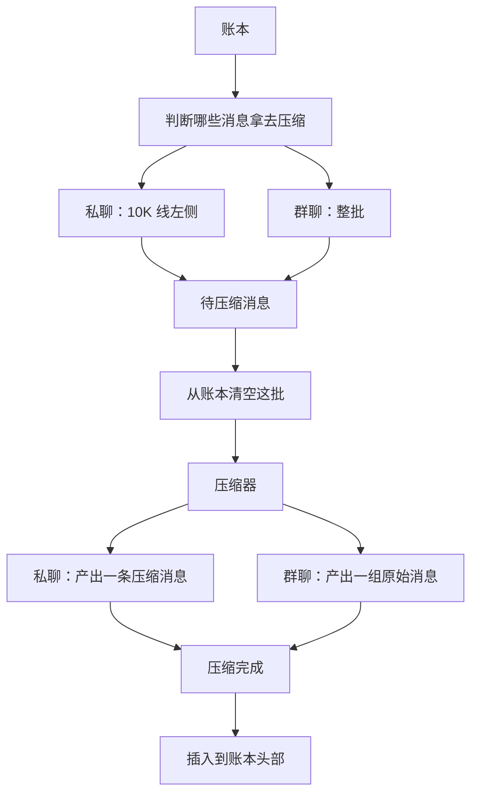

# 消息管理与上下文压缩

## 功能目标

账本是内存态唯一真相源。压缩就是把账本收进上下文预算里：

- 超出预算的消息，从账本里移走
- 群聊移走就没了
- 私聊移走前先压成一条摘要，插回账本头部

不生成「摘要消息 + 历史条目」这种第二形态，账本里除了私聊那一条摘要，其余都是原始消息。

## 数据结构

```python
ledger = {
    "messages": [ ... ],        # 原始消息，按 timestamp 有序
    "current_summary": "",      # 只有私聊会写；群聊恒为空
}
```

`messages` 里只有私聊会有一条 `kind="context_summary"` 的消息，且恒在第一位。

## 压缩流程



账本只有一条路：判断、清空、压缩、插回头部。分叉只在两处——判断哪些消息拿去压缩、压缩器内部。

### 判断：哪些消息拿去压缩

`_split_by_budget(messages, budget, keep_from_timestamp=None) -> (待压缩, 保留)`

从最新往前收到预算为止，收下的留在账本，没收下的就是待压缩那批。

工具块在选块阶段就不进候选，所以两侧都不会出现半条工具链。`keep_from_timestamp` 用于入场整理，触发点之前的整块不进保留侧。

### 压缩器

**群聊**：`_compress_snapshot(messages, budget)`

整批进去，去掉所有工具，按预算留尾部一组原始消息。纯内存计算，不调用模型。

**私聊**：`_compress_private(messages, budget, provider_text_chat, ...)`

方法1 把待压缩那批拼成提示词交给模型压成一条摘要；模型报错或返回空时，内部直接降级到方法2——也就是群聊那套 `_compress_snapshot`。

返回 `(写进账本的头部内容, 新的 current_summary)`。走方法1 时头部是一条摘要消息、`current_summary` 有值；降级时头部是一组原始消息、`current_summary` 为空。

## 触发时机

### 群聊

| 时机 | 行为 |
|---|---|
| 入账后体积超阈值 | 规则压缩，整批去工具，按预算留尾部 |
| 离场→在场 | `organize_on_group_enter`，带 `keep_from_timestamp`，触发点之前整块不进保留侧 |
| 全局条数超 `TOTAL_MESSAGE_LIMIT` | 压缩最旧的那个群聊会话 |

群聊**不调用模型**。

### 私聊

| 时机 | 行为 |
|---|---|
| 入账后体积超阈值 | 起一个后台任务 `_schedule_private_compression`，同会话只保留一个 |
| 后台任务执行 | `maybe_llm_compress_private`：切出左侧 → 清空 → `await` 模型 → 摘要插头部；模型失败则降级成群聊压缩，插一组原始消息 |

私聊**调用模型**，但模型不是必需的：没有分析模型配置、拿不到 provider、或调用报错时，压缩器内部自动降级到群聊那套规则压缩，不产摘要。

## 锁

两把锁，都按会话独立。

**账本锁** `_chat_locks[chat_id]`：保护该会话的 `messages` 列表。同一会话串行，不同会话互不阻塞。

- `_get_or_create_ledger` 用 `dict.setdefault` 原子创建，不加锁
- 跨会话只读（`get_all_chat_ids`、`_collect_referenced_cache_paths` 无 chat_id 分支）取 `list(self._ledgers.items())` 快照遍历
- `close` 直接清空，卸载路径上不会再有入账

**压缩锁** `_compression_locks[chat_id]`：防止同一会话同时跑两个压缩。拿不到就跳过，不排队。

### 持锁区间

**群聊压缩**：全程持账本锁。压缩是纯内存计算，瞬间完成，期间入账在锁外排队，解锁后按 timestamp 入账，自然落在保留区之后。

**私聊压缩**：账本锁只持两段——切出左侧并清空、写回摘要。`await` 模型那几十秒释放，消息照常入账。

`await` 之前就把待压缩那批清出账本，所以写回时账本里只剩保留区和期间新入账的消息，直接插头部即可，不需要按 id 认人，也不会有消息两边都不落。

## 读取规则

`get_formal_context(chat_id)` 直接返回账本里的消息副本。

群聊账本只有消息，私聊账本第一条是摘要。不再有「摘要前缀 + 连续块」的拼装。

`partition_dialogue` / `partition_dialogue_raw` 仍可用来按边界切分，但账本本身不再区分历史段和当前段。

## 计量与预算

两种预算，职责不同：

| 配置 | 用途 | 谁看 |
|---|---|---|
| `max_conversation_tokens` × `context_compression_threshold` | 触发线：会话涨到多少开始压 | 账本 `_should_compress` |
| `content_retain_tokens` | 保留预算：压完留多少 | 压缩器 |

`max_conversation_tokens` 会与绑定模型的上下文上限取较小正数。配置为 0 时表示不设插件侧上限。

`MIN_RETAIN_COUNT = 7`：预算再紧也至少留 7 条，避免压到模型看不见最近对话。

## 全局限额

`TOTAL_MESSAGE_LIMIT = 100000`：所有会话的消息总条数水位。

超过时不删消息，而是找出最早消息时间戳最小的那个群聊会话，对它跑一次 `organize_context(mode="group_rule")`。压缩后总量下降，下次入账再检查。

私聊会话不参与这个挑选。

## 消息编号

每个会话一个游标 `_quote_cursors[chat_id]`，入库时分配 `quote_no`，**生命周期内单调递增**，压缩后不复位、不重排。

压缩只是搬运消息对象，编号写在消息上不动。所以模型上一轮看到的 `#n` 永远不会在下一轮指向别人；被压掉的消息查不到目标，但不会误指。

## 媒体缓存

压缩丢弃消息时，同步清理不再被引用的插件媒体缓存。

会话仍在调度中（防抖记录、秘书单飞、运行中的工作任一存在）时只登记待清理、不删文件，等调度收口后再补做。

私聊摘要消息持有被压缩消息的图片引用，这些路径不会被清理。

## 异常降级

| 情况 | 行为 |
|---|---|
| 私聊 LLM 调用失败或返回空 | 压缩器内部降级到群聊方法：待压缩那批去工具、按预算留尾部，结果插头部，不产摘要 |
| 群聊压缩中途抛异常 | 账本原样放回，异常继续上抛 |
| 重复压缩抢锁失败 | 跳过，不排队 |
| 全局限额压不动某个会话 | 跳过它，继续下一个候选；都压不动就等下轮入账 |

## 模块关系

```text
FrontDesk 私聊缓存
  → _schedule_private_compression（后台任务，同会话去重）
  → maybe_llm_compress_private
      → _split_by_budget（切出待压缩那批）
      → _compress_private
          方法1 provider.text_chat → 一条摘要消息
          方法2（降级）_compress_snapshot → 一组原始消息
      → 结果插账本头部

FrontDesk 群聊入场
  → organize_on_group_enter(keep_from_timestamp)
      → _rule_organize
          → _split_by_budget
          → _compress_snapshot（去工具 + 按预算留尾部）
          → 插账本头部

ConversationLedger.add_messages
  → _should_compress 为真且是群聊 → organize_context(mode="group_rule")
  → _enforce_total_message_limit
```
